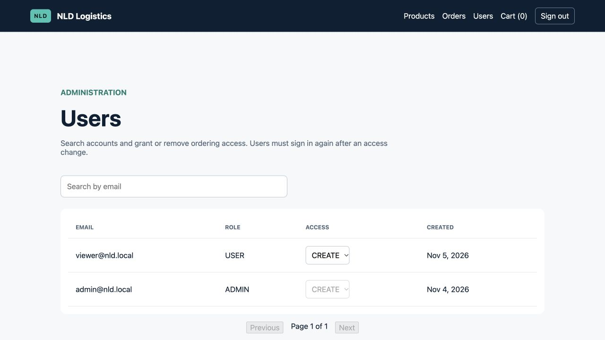

# NLD Logistics Assessment

A full-stack logistics ordering application built with Angular, Express, TypeORM, and PostgreSQL. It includes authentication, permissioned product browsing, transactional ordering, stock-safe cancellation, a signal-based cart, and order history.

## Architecture

```text
Angular 21 client (localhost:4200)
            |
            | HTTP / JSON
            v
Express 5 API (localhost:3000)
            |
            | TypeORM (explicit migrations)
            v
PostgreSQL 17 (localhost:5432)
```

- `frontend/` — standalone Angular application and browser UI.
- `backend/src/app.ts` — Express middleware and route composition.
- `backend/src/server.ts` — database initialization, HTTP listener, and graceful shutdown.
- `backend/src/config/env.ts` — runtime environment validation with Zod.
- `backend/src/database/entities/` — TypeORM object-to-table mappings.
- `backend/src/database/migrations/` — versioned, reversible database schema changes.
- `backend/src/database/seeds/` — deterministic development data.
- `docker-compose.yml` — local PostgreSQL service and persistent named volume.

## Requirements

- Node.js 24 (`.nvmrc`)
- npm
- Docker with Docker Compose (Colima is supported on macOS)

## Local setup

1. Install dependencies if they are not already installed:

   ```bash
   cd backend && npm ci
   cd ../frontend && npm ci
   ```

2. Create the backend environment file:

   ```bash
   cp backend/.env.example backend/.env
   ```

   The committed values are development placeholders. Use a long random `JWT_SECRET` and secret management in a deployed environment.

3. Start PostgreSQL and wait for it to become healthy:

   ```bash
   docker-compose up -d postgres
   docker-compose ps
   ```

4. Apply the schema and seed products:

   ```bash
   cd backend
   npm run migration:run
   npm run seed
   ```

   The seed uses product SKU as its stable key, so it is safe to run repeatedly without creating duplicates.

   Create or update a development ADMIN with credentials supplied only at execution time:

   ```bash
   ADMIN_EMAIL=admin@example.com ADMIN_PASSWORD='a-long-development-password' npm run seed:admin
   ```

   The ADMIN can manage registered users from `/admin/users` or through `PATCH /admin/users/:id/access`. Backend enforcement changes immediately; signing in again refreshes the Angular navigation cached in that user's browser session.

5. Start the API and Angular app in separate terminals:

   ```bash
   cd backend && npm run dev
   cd frontend && npm start
   ```

6. Check `http://localhost:3000/health` and open `http://localhost:4200`.

## Verification commands

```bash
cd backend
npm run build
npm test
npm run migration:show
npm run verify:concurrency
```

`verify:concurrency` temporarily sets one seeded product to stock 1, submits two competing orders, submits two competing cancellations, asserts one success/one rejection for each pair, and restores all original data in `finally` cleanup.

## Production containers

The production stack builds minimized backend and Angular/Nginx images, runs migrations before API startup, keeps PostgreSQL internal, and serves the complete application at `http://localhost:8080`:

```bash
DATABASE_PASSWORD='replace-with-a-database-password' \
JWT_SECRET='replace-with-at-least-32-random-characters' \
PUBLIC_ORIGIN='http://localhost:8080' \
docker-compose -f docker-compose.prod.yml up --build
```

Angular calls `/api`; Nginx proxies that path to Express. Browser routes fall back to `index.html`, allowing direct navigation to `/products`, `/orders`, and `/cart`.

Production secrets must come from the deployment platform. Do not commit a production `.env` file.

The Angular native macOS builder currently crashes on the development machine with an allocator error. The project builds successfully in Linux, so use the verified container path:

```bash
docker run --rm \
  --mount 'type=bind,src=/Users/kartikeykhosla/Desktop/nld-logistics-assessment/frontend,dst=/app' \
  --mount 'type=volume,src=nld_frontend_node_modules,dst=/app/node_modules' \
  --workdir /app \
  node:24-alpine \
  sh -lc 'npm ci && npm run build -- --progress=false'
```

## Schema and integrity choices

- TypeORM uses `synchronize: false`. Migrations are reviewed and deployed explicitly instead of allowing runtime code to mutate the schema.
- Money uses PostgreSQL `numeric(12,2)` and is represented as strings at the ORM boundary to avoid JavaScript floating-point rounding.
- Database checks prevent negative stock and money, and require positive order-item quantities.
- Order-item prices are snapshots. A later product price update cannot change historical order totals.
- Foreign keys preserve history: referenced users/products are restricted from deletion, while order items cascade only when their parent order is deleted.
- Timestamps use `TIMESTAMPTZ`; application and API date handling will use UTC.
- Indexes cover order ownership, status/date filtering, and order-item joins required by the assessment queries.

## Current API

- `POST /auth/register` — assessment contract: body `{ "email", "password", "role": "ADMIN" | "USER" }`; new accounts receive `CREATE` access because access is not part of the required payload.
- `POST /auth/login` — returns a JWT and the public user profile.
- `GET /products?search=&page=1&limit=10` — authenticated, case-insensitive name/SKU search with pagination.
- `GET /admin/users?search=&page=1&limit=20` — ADMIN-only searchable user list; password hashes are never selected.
- `PATCH /admin/users/:id/access` — ADMIN-only; body `{ "access": "VIEW" | "CREATE" }`.
- `POST /orders` — ADMIN or `USER + CREATE`; body `{ "items": [{ "sku", "qty" }] }`; transactionally locks products by SKU, validates/deducts stock, and creates the order/items.
- `GET /orders?status=&from=&to=&page=1&limit=10` — ADMIN sees all orders; USER sees only their own.
- `POST /orders/:id/cancel` — ADMIN or owning `USER + CREATE`; restores stock exactly once in a transaction.
- `GET /health` — verifies both API and database readiness.

The public registration route accepts `role` because that is the assessment's explicit mandatory contract. In a production system, public ADMIN self-registration should be removed and ADMIN provisioning should be restricted to a protected operational workflow. The API, not Angular guards, remains the authoritative security boundary.

## Assessment decisions and assumptions

- **Public registration:** accepts the assessment's required `ADMIN`/`USER` role and defaults access to `CREATE`, since the required registration payload has no access field and a newly registered USER must be able to exercise order creation. ADMIN access-management remains ADMIN-only.
- **Initial status:** new orders are `PENDING`; the assessment specifies no confirmation endpoint.
- **Cancellation:** allowed for ADMIN or the owning `USER + CREATE`, and only from `PENDING`/`CONFIRMED`.
- **Dates:** timestamps are UTC. A date-only `from` begins at `00:00:00.000Z`; a date-only `to` includes through `23:59:59.999Z`. Full timestamps must end in `Z`.
- **Money:** backend calculations use integer cents; PostgreSQL persists exact `numeric(12,2)` values.
- **Concurrency:** product and order rows use TypeORM pessimistic write locks inside transactions. Product locks are acquired in ascending ID order to reduce deadlock risk.

## Testing strategy

- Unit tests cover money conversion, request validation, authentication, and access enforcement.
- Supertest checks the Express health/error contract.
- The database concurrency verifier exercises real TypeORM transactions and PostgreSQL row locks rather than mocking them.
- TypeScript compilation and the Angular production build are required verification steps.
- Production dependency audits are run with `npm audit --omit=dev` for both packages.

## Reviewer walkthrough

1. Register a USER with the required role field and sign in.
2. Browse/search/paginate products, add products to the cart, and place an order.
3. Observe stock deduction and the order in history.
4. Cancel it and observe the stock restoration and `CANCELLED` state.
5. Optionally sign in as ADMIN to search users and change USER access through `/admin/users`.

### Admin user management



The ADMIN-only screen provides searchable, paginated access management without exposing password hashes. ADMIN rows cannot be downgraded from the UI.

## Known scope boundaries

- No order-confirmation endpoint was requested, so created orders remain `PENDING` until cancelled.
- Protected requests reload current role/access from PostgreSQL, so deletion and access changes are enforced immediately. The Angular navigation snapshot refreshes on the user's next sign-in.
- The cart is intentionally in-memory. Persisted carts, refresh tokens, email verification, password reset, audit logs, and full admin UI are sensible production extensions but outside the four-day assessment scope.
- CI/CD and cloud-specific infrastructure are not included; the production Compose stack is the portable deployment reference.
